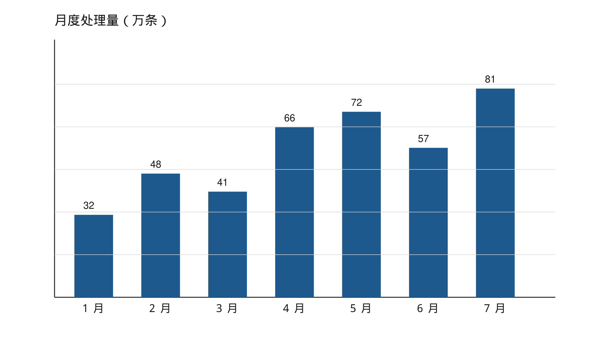
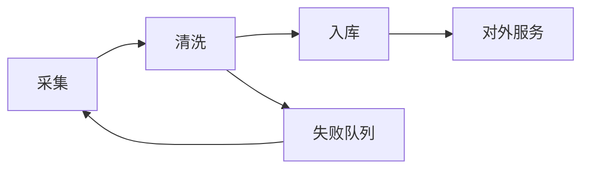

# 数据处理平台季度回顾

这一份稿件用来演示模板切换：它同时含有一级到三级标题、普通段落、有序与无序列表、任务列表、表格、宽表、代码块、图片、公式、引用、提示块和双链。切换模板时会看到同样的内容在不同版式下的差别。

## 一、本季度做了什么

平台在这一季度把「采集—清洗—入库—对外服务」四段流程收成了一条链路。原先分散在三个脚本里的校验逻辑合并成一个模块，重复告警从每天 40 余条降到 6 条左右。

主要改动集中在三处：

1. **采集层**加了断点续传，单个源失败不再阻塞整批；
2. **清洗层**的规则改成配置驱动，改规则不用改代码；
3. **对外接口**补了分页和字段筛选，下游不用再拉全量。

顺带修了一批历史问题，其中影响最大的是时区处理：原来按服务器本地时间切日，跨时区汇总时会出现重复计入。现在统一按 UTC+8 切分，并把切换前的数据做了回溯修正。

### 采集层

采集任务按源分组，每组一个队列。失败重试采用指数退避，最多五次；超过五次的进入人工队列。

- 支持 HTTP 与 SFTP 两类源；
- 单源限速可配，默认每秒 20 条；
- 失败原因落到独立表，便于按源统计。

### 清洗层

清洗规则写在一个 YAML 文件里，由 [[规则说明]] 描述字段含义。改动后热加载，不需要重启进程。

### 对外服务

接口返回分页结果，`page_size` 上限 500。默认按更新时间倒序，支持按 `since` 增量拉取。

## 二、数据

下面的表格是七个源的本季度处理量。第二张是宽表，用来测试横向排版：列多的时候会自动缩排，必要时可以把这一页设成横向。

| 数据源 | 记录数（万） | 失败率 | 平均延迟（秒） | 负责人 |
| --- | ---: | ---: | ---: | --- |
| 订单主表 | 1284.6 | 0.12% | 1.8 | 张启 |
| 支付流水 | 962.1 | 0.08% | 2.4 | 李桦 |
| 物流轨迹 | 3418.7 | 0.31% | 6.2 | 王砚 |
| 售后工单 | 87.4 | 0.22% | 3.1 | 张启 |
| 商品档案 | 42.9 | 0.01% | 0.9 | 陈叙 |
| 会员等级 | 18.3 | 0.00% | 0.6 | 李桦 |
| 渠道结算 | 206.5 | 0.45% | 8.7 | 王砚 |



图 1　月度处理量变化（万条）

### 宽表：字段级对照

| 字段 | 类型 | 必填 | 来源系统 | 清洗规则 | 下游用途 | 备注 |
| --- | --- | --- | --- | --- | --- | --- |
| order_id | string(32) | 是 | 订单主表 | 去空格、转大写 | 全链路主键 | 与支付流水需对齐 |
| user_id | string(24) | 是 | 会员等级 | 空值置 UNKNOWN | 用户维度汇总 | 历史数据有 0.3% 空 |
| pay_time | datetime | 否 | 支付流水 | 统一 UTC+8 | 时效统计 | 未支付为空 |
| amount | decimal(12,2) | 是 | 支付流水 | 保留两位、去千分位 | 金额汇总 | 退款为负 |
| channel | string(16) | 是 | 渠道结算 | 映射到标准枚举 | 渠道分析 | 枚举见附录 |
| status | string(8) | 是 | 订单主表 | 小写化 | 状态机判断 | 与物流状态不同 |
| create_at | datetime | 是 | 订单主表 | 统一 UTC+8 | 分区键 | 不做时区转换 |
| update_at | datetime | 是 | 订单主表 | 统一 UTC+8 | 增量拉取 | 变更即更新 |
| remark | text | 否 | 售后工单 | 截断 500 字 | 人工排查 | 含换行需转义 |
| ext_json | json | 否 | 订单主表 | 校验可解析 | 扩展字段 | 结构不固定 |

## 三、怎么跑起来

本地起一份最小环境只要三步。代码块里的行号是排版时加的，原文没有。

```bash
git clone https://example.com/data-platform.git
cd data-platform
python3 -m venv .venv && source .venv/bin/activate
pip install -r requirements.txt
python3 -m platform.cli run --source order --since 2026-10-01
```

配置长这样，改完热加载：

```yaml
sources:
  order:
    driver: http
    url: https://example.com/api/orders
    rate: 20
    retry:
      max: 5
      backoff: exponential
  logistics:
    driver: sftp
    host: sftp.example.com
    path: /daily/*.csv
cleaning:
  timezone: Asia/Shanghai
  rules: rules/order.yaml
```

核心的切分逻辑在 `split.py` 里，读起来不复杂：

```python
def split_batches(rows, size=500):
    """按 size 切片，末批可能不足"""
    for i in range(0, len(rows), size):
        yield rows[i:i + size]

def run(source, since=None):
    rows = fetch(source, since=since)
    ok = fail = 0
    for batch in split_batches(rows):
        try:
            write(batch)
            ok += len(batch)
        except Exception as e:
            fail += len(batch)
            log.warning("batch failed: %s", e)
    return {"ok": ok, "fail": fail}
```

线上统计口径按下式计算，其中 $n$ 为当日批次数，$f_i$ 为第 $i$ 批的失败条数：

$$
\bar{f} = \frac{1}{n}\sum_{i=1}^{n} f_i , \qquad R = 1 - \frac{\sum f_i}{\sum r_i}
$$

其中 $R$ 为成功率，$r_i$ 为该批应处理条数。

## 四、链路



## 五、几个容易踩的坑

> 时区不是「加八小时」这么简单。夏令时、跨日切分、以及上游给的是本地时间还是 UTC，三件事要分开确认。

> [!warning] 回溯修正会覆盖原分区
> 修正脚本默认按分区重写。跑之前先确认目标分区没有下游依赖，否则会把已修正的数据再次覆盖。

> [!tip] 想看单源表现
> 用 `--only` 只跑一个源，日志会按批打印耗时，比看汇总表快。

剩下的待办：

- [x] 断点续传上线
- [x] 时区统一
- [ ] 失败队列的人工处理界面
- [ ] 把字段级对照表接进文档站
- [ ] 和 [[下游接口约定]] 对齐分页参数

## 六、结论

这一季度的工作没有引入新系统，主要是把已有链路收拢、补齐可观测性。下一步优先做失败队列的处理界面，其次是文档站。相关背景见 [[立项说明]]。
